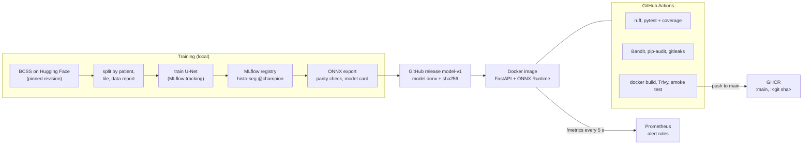

# histo-seg-service

[](https://github.com/fyakkan/histo-seg-service/actions/workflows/ci.yml)

My M.Sc. thesis works on blood vessel segmentation in H&E whole-slide images. This repository practises the production side on public data: train, track, package, test, scan, ship and monitor a segmentation model.

> **Important**
> - This is a **portfolio project**, trained on a **small public dataset** (BCSS, 151 regions from 151 patients).
> - It is **not a medical device** and **not for clinical use**.
> - The monitoring demo uses **simulated** stain drift (colours shifted in software).

## What it does

A U-Net segments blood vessels in 256×256 H&E tiles. Around the model sits the MLOps lifecycle:

- **Data**: download from a pinned dataset revision, patient-grouped train/val/test split, non-overlapping tiles, a data report with class statistics.
- **Training**: config-driven, seeded, tracked in MLflow (parameters, per-epoch metrics, artifacts); the model is registered and promoted to `champion` only if it beats the current one.
- **Packaging**: export to ONNX with a PyTorch-vs-ONNX parity check, model card, checksum; published as a GitHub release.
- **Serving**: FastAPI + ONNX Runtime (CPU) in a non-root Docker container; the model's SHA-256 is verified at startup.
- **CI/CD**: lint, tests with coverage, Bandit, pip-audit, gitleaks, Docker build, Trivy image scan and a container smoke test on every pull request; after a merge to main the scanned image is pushed to GitHub Container Registry (`ghcr.io/fyakkan/histo-seg-service`).
- **Monitoring**: Prometheus metrics and alert rules, including a stain-drift score that compares incoming images with the training data.

## Architecture



## Quickstart

Quickest: pull the published image (model included, no login needed):

```bash
docker run --rm -p 127.0.0.1:8000:8000 ghcr.io/fyakkan/histo-seg-service:main
curl -s http://127.0.0.1:8000/health
```

With Prometheus and the drift demo (needs Docker and the GitHub CLI `gh`):

```bash
make model          # download model-v1 from the release and verify its checksum
make up             # API on 127.0.0.1:8000, Prometheus on 127.0.0.1:9090
curl -s http://127.0.0.1:8000/health
curl -s -F "file=@tests/fixtures/images/TCGA-AC-A2QH-DX1_xmin42173_ymin16859_MPP-0.2500_y01280_x02048.png;type=image/png" \
     http://127.0.0.1:8000/predict | head -c 300
make demo-drift     # needs `make setup` for the Python client; ~3 minutes
make down
```

Reproduce everything from scratch (Python 3.12; training used an Apple M4 GPU via MPS):

```bash
make setup          # .venv with pinned requirements
make data           # download (~4.9 GB, resumable), split, tiles, reports/data_report.md
make train          # ~40 min; MLflow UI: make mlflow-ui
make evaluate       # reports/model_report.md
make export         # artifacts/model.onnx, checksum, model card
make test lint security docker-build smoke
```

## Results

All numbers come from the runs described in [`reports/`](reports/).

| | Value | Source |
|---|---|---|
| Patients train / val / test | 106 / 23 / 22 | `configs/splits.json` |
| Tiles train / val / test | 5055 / 752 / 1231 | `reports/data_report.md` |
| Blood vessel share of labelled training pixels | 0.52 % | `reports/data_report.md` |
| Training | 12 epochs, 39.9 min (time budget), best epoch 10 | `reports/model_report.md` |
| Validation Dice (pooled) | 0.3223 | `reports/model_report.md` |
| **Test Dice (pooled, 22 patients)** | **0.3327** (IoU 0.1995) | `reports/model_report.md` |
| Test Dice per patient | 0.2318 ± 0.2231 (median 0.1630, range 0–0.6858) | `reports/model_report.md` |
| ONNX vs PyTorch max difference | 1.24e-05 | `make export` |
| Drift score, normal vs shifted windows | max 0.58 vs min 1.72 (threshold 0.8) | `reports/drift_calibration.md` |
| Test Dice (pooled) unchanged vs demo stain shift | 0.3327 vs 0.1392 (whole-set drift score 0.05 vs 1.97) | `reports/drift_calibration.md` |
| Docker image size, before → after NumPy colour deconvolution | 930 MB → 650 MB (Python packages 411 MB → 196 MB) | `make docker-build`, `docker history` |
| Test coverage in CI | 35.7 % overall; serving code 96–100 % | CI `lint-test` job |

Blood vessels are a rare and thin structure here (0.52 % of labelled pixels), so pixel overlap is hard and the Dice is modest. It is reported as measured. Per-patient scores vary widely.

## MLOps capability → where in the repo

| Capability | Where |
|---|---|
| Reproducible data pipeline, patient-grouped split | `src/histoseg/data/`, `configs/data.yaml`, `configs/splits.json` |
| Experiment tracking, model registry, champion alias | `src/histoseg/train.py` (MLflow, SQLite backend) |
| Evaluation on held-out patients | `src/histoseg/evaluate.py`, `reports/model_report.md` |
| Model packaging and versioned release | `src/histoseg/export_onnx.py`, release `model-v1` |
| Serving API with input validation | `src/histoseg/serving/app.py`, `inference.py` |
| Container (multi-stage, non-root, health check) | `Dockerfile`, `.dockerignore` |
| Tests (unit, API, model contract, quality gate) | `tests/` |
| CI with security scanning | `.github/workflows/ci.yml`, `make security` |
| Image registry (published on every merge to main) | `.github/workflows/ci.yml` (docker job), `Dockerfile` labels |
| Dependency updates | `.github/dependabot.yml` |
| Metrics, drift detection, alerting | `src/histoseg/serving/metrics.py`, `drift.py`, `monitoring/` |

## Design decisions

- **Patient-grouped split.** Tiles from one slide look alike; splitting by tile would leak near-copies into the test set. Patients are split first (70/15/15, fixed seed), and a test checks no patient is in two splits.
- **One preprocessing function.** `src/histoseg/preprocess.py` is used by both training and serving, and tests check that serving sends exactly its output to the model, preventing training–serving skew.
- **ONNX for serving.** The container needs ONNX Runtime (CPU) but not PyTorch; the export is checked against PyTorch to 1e-4.
- **Checksum-verified model release.** The model is not in git. It is published as a GitHub release; `configs/serve.yaml` holds its SHA-256 and the service refuses to start if the file differs.
- **Allowlist `.dockerignore`.** Everything is excluded unless named, so data, secrets and local files cannot slip into the image.
- **No scikit-image in the image.** Colour deconvolution (`rgb2hed`) is a few lines of NumPy. `src/histoseg/stain.py` implements it, a test checks it against `skimage.color.rgb2hed` (within 1e-6), and the image drops scikit-image and SciPy (930 → 650 MB).
- **Non-root container.** The service runs as an unprivileged user; Debian security updates are applied at build time.
- **Stain-drift monitoring.** H&E staining varies between labs and scanners. The service measures each image's mean haematoxylin and eosin optical density and compares the last 50 requests with training statistics. The threshold was calibrated on held-out tiles ([`reports/drift_calibration.md`](reports/drift_calibration.md)).

## Monitoring

`make up` starts the API and Prometheus. Metrics at `http://127.0.0.1:8000/metrics` include request counts by endpoint and status, request and inference latency histograms, the predicted vessel fraction, per-request H and E optical density, the drift score and threshold, and the model version.

Alert rules (`monitoring/alert_rules.yml`): **StainDriftHigh** (drift score above threshold for 1 min), **HighErrorRate** (5xx above 5 % for 5 min), **HighLatencyP95** (p95 `/predict` latency above 1 s for 5 min). Alerts are visible at `http://127.0.0.1:9090/alerts`; there is no dashboard or notification channel in this project.

`make demo-drift` sends the fixture tiles unchanged for a minute, then with a simulated stain shift, and prints the drift score and alert state until StainDriftHigh fires.

Example run (Apple M4, Docker Desktop): during the normal minute the drift score stayed at about 0.40 and the alert was inactive; after the shift it rose to about 1.75 within 5 seconds, the alert became *pending* after 15 seconds and *firing* after 81 seconds (the rule requires 1 minute above threshold).

## Limitations

- Small dataset: 151 regions, one per patient; 22 test patients. Results would change with other data.
- The input images were colour-normalised by the dataset mirror, so natural stain variation is smaller than in raw slides.
- Validation Dice was noisy between epochs (0.12–0.32); training was capped at 40 minutes.
- The model sees 256×256 tiles at 0.5 µm/px; whole-slide inference is out of scope.
- Drift in the demo is simulated; the threshold was calibrated on held-out tiles, not on real scanner changes.
- Under the simulated demo shift the test Dice drops from 0.33 to 0.14 even though training used stain augmentation, so the drift alert points at a real loss of quality.
- The Docker image is about 650 MB; the largest parts are the Python packages (ONNX Runtime, NumPy), the model (98 MB) and the Debian base.
- Training, evaluation and export need PyTorch and the dataset and are not run in CI.

## Data and licence

Data: **BCSS** (Breast Cancer Semantic Segmentation), CC0 1.0, used via the Hugging Face mirror `MedOtter/BCSS` at a pinned revision (see `configs/data.yaml`). Eight small tiles are included in `tests/fixtures/` for tests.

> Amgad M, Elfandy H, Hussein H, et al. Structured crowdsourcing enables convolutional segmentation of histology images. *Bioinformatics* 35(18):3461–3467, 2019. doi:10.1093/bioinformatics/btz083

Code: MIT, see [LICENSE](LICENSE).
